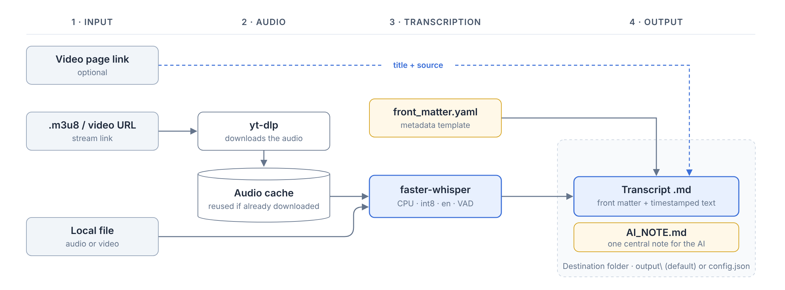

# whisper-transcription

This tool was born out of the need to study from videos or audio recordings that
have no subtitles or accessible transcript. When I study something, I usually share
the content with an AI to discuss it while I watch the video, and for that I need
the text.

The tool generates a `.md` transcript from a link to the video or stream (depending
on the website, the link will be of one type or another; for example, `.m3u8`) or
from a local audio/video file. Transcription runs on your machine, on CPU, with
faster-whisper: the audio is not sent to any external service.



## Qué hace

1. **Descarga el audio** de un enlace `.m3u8`/URL con `yt-dlp`, o usa un archivo local. El audio descargado se reutiliza si se vuelve a transcribir el mismo vídeo.

   **FAQ**

   - **What is `.m3u8`?**  
     Many videos on websites are not served as a single file (`.mp4`, `.mp3`...). They are
     split into many short fragments that the player requests one by one while you watch.
     The `.m3u8` link is the index of those fragments. To download the audio, the tool needs
     that stream link; the link of the web page where the video is shown is optional and is
     only used to suggest the title and fill the `source` field.
   - **What is `yt-dlp`?**  
     An open-source program ([yt-dlp](https://github.com/yt-dlp/yt-dlp)) specialized in
     downloading audio and video from websites. Here it is used to download only the audio.
   - **Is it necessary to download the audio? Can't it just listen to the link and transcribe?**  
     In this first version, the audio has to be downloaded. The file is stored locally in
     `%LOCALAPPDATA%\whisper-transcription\audio\`. Future versions plan automatic deletion
     and/or transcription without downloading the audio.

2. **Transcribe** con faster-whisper (`int8`, CPU, idioma `en`, VAD para saltar silencios).

   **FAQ**

   - **What is `faster-whisper`?**  
     An open-source reimplementation ([faster-whisper](https://github.com/SYSTRAN/faster-whisper))
     by SYSTRAN of [Whisper](https://github.com/openai/whisper), OpenAI's speech-to-text model.
     It uses the same models with an optimized computation engine, so it runs faster and uses
     less memory.
   - **What do the parameters mean?**  
     `int8`: the model is loaded in a compressed numeric format (faster, less memory).
     CPU: it runs on the processor, no graphics card needed. `en`: the audio is assumed to be
     in English. VAD (Voice Activity Detection): silent parts are skipped. These values are
     fixed by default for the best performance; future versions plan to make them
     configurable when needed.

3. **Genera un `.md`** en la carpeta `output\` de la herramienta (destino configurable; ver [Destino](#destino)) con:
   - front matter YAML (`title`, `source` = enlace de la página del vídeo, `product`, `event_date`, `language`, `transcribed_on`, `model`, `duration`), configurable (ver [Personalización](#personalización))
   - el texto en párrafos de ~60–90 s con marca de tiempo `[HH:MM:SS]`

   La nota para la IA sobre los posibles errores de la transcripción no va en cada `.md`, sino en un archivo central, `AI_NOTE.md`, en la raíz del destino.

## Requisitos

- Windows
- Python 3.12, 3.13 o 3.14 con `tkinter` (instalador oficial de python.org)
- Dependencias (`requirements.txt`): `faster-whisper`, `av<19`, `yt-dlp`

## Uso

### Interfaz (recomendado)

Doble clic en `ejecutar.bat`. La primera vez crea el entorno virtual e instala las dependencias (tarda unos minutos).

| Campo | Contenido |
|---|---|
| Página del vídeo | Enlace de la página donde está el vídeo (opcional); propone el título y se guarda en el campo `source` |
| Título | Revisar acrónimos y apóstrofos |
| Fecha del evento | `AAAA-MM-DD` (opcional); se usa como prefijo del nombre del archivo |
| Producto | Subcarpeta de destino (`planning`, `fccs`, `arcs`...); obligatorio |
| Enlace .m3u8 o archivo | Enlace del stream o archivo local de audio/vídeo |
| Modelo | `base` (rápido) · `small` (por defecto) · `medium` · `large-v3-turbo` |

**Cómo obtener el enlace `.m3u8`:** en Chrome, `F12` › `Network` › filtrar por `m3u8` › reproducir el vídeo › copiar la URL. El enlace caduca; si da error `403`, copiar uno nuevo.

### Línea de comandos

```bash
python transcribe.py "URL_M3U8_O_ARCHIVO" --title "Título" --product planning --event-date 2026-10-15 --model small --page-url "URL_DE_LA_PAGINA"
```

## Destino

Por defecto, el `.md` se guarda en `output\<producto>\`, dentro de la carpeta de la herramienta. La carpeta `output\` se crea automáticamente y está excluida del repo.

Para guardarlo en otra carpeta:

1. Copia `config.example.json` como `config.json`, en la misma carpeta.
2. Cambia `output_dir` por la ruta de destino. En JSON, las barras invertidas se escriben dobles (`\\`).

```json
{
  "output_dir": "D:\\Notes\\transcripts"
}
```

- `config.json` está excluido del repo (`.gitignore`): cada usuario tiene el suyo.
- Una ruta relativa se interpreta desde la carpeta de la herramienta.
- Para añadir un producto (subcarpeta), añádelo a la lista `PRODUCTS` de `transcribe.py`.
- La interfaz muestra la ruta de destino activa bajo el campo Producto.

## Personalización

### Front matter

1. Copia `front_matter.example.yaml` como `front_matter.yaml`, en la misma carpeta.
2. Añade, quita o reordena líneas. Los marcadores entre llaves se sustituyen por su valor:

| Marcador | Valor |
|---|---|
| `{title}` | Título (las comillas se añaden automáticamente) |
| `{source}` | Enlace de la página del vídeo (las comillas se añaden automáticamente) |
| `{product}` | Subcarpeta elegida |
| `{event_date}` | Fecha del evento |
| `{language}` | Idioma (`en`) |
| `{transcribed_on}` | Fecha de la transcripción |
| `{model}` | Modelo de Whisper |
| `{duration}` | Duración del audio |

Las líneas sin marcador (p. ej. `author: Jane Doe`) se copian tal cual. `front_matter.yaml` está excluido del repo.

### Nota para la IA

`AI_NOTE.md` se crea en la raíz del destino la primera vez que se transcribe, como copia de `ai_note.example.md` (nota general incluida en el repo). Después se edita directamente en el destino; la herramienta nunca lo sobrescribe. Para que la IA la tenga en cuenta, compártela junto con los `.md`.

### Actualizar los `.md` existentes

El botón **Actualizar .md existentes** reescribe el front matter de todos los `.md` de las subcarpetas de producto con la plantilla actual. No modifica nada desde `## Transcript` hacia abajo.

- Un campo que se quita de la plantilla se elimina de los archivos. Si después se vuelve a añadir, los archivos antiguos lo tendrán vacío.
- Un campo nuevo con marcador queda vacío en los archivos que no lo tenían.
- Los archivos sin `## Transcript` se omiten.

## Archivos

| Archivo | Función |
|---|---|
| `ejecutar.bat` | Localiza Python, crea el venv, instala dependencias y abre la interfaz |
| `app.py` | Interfaz `tkinter`; ejecuta el proceso en segundo plano y muestra el progreso |
| `transcribe.py` | Lógica: descarga, transcripción y escritura del `.md`; también usable por CLI |
| `requirements.txt` | Dependencias de Python |
| `config.example.json` | Plantilla de `config.json` para cambiar el destino |
| `front_matter.example.yaml` | Plantilla por defecto del front matter |
| `ai_note.example.md` | Nota general para la IA; texto inicial de `AI_NOTE.md` |
| `docs/flow.png` | Esquema del flujo de la herramienta |

## Rutas

| Ruta | Contenido |
|---|---|
| `output\<producto>\` | Transcripciones `.md` (destino por defecto; excluido del repo) |
| `config.json` | Destino personalizado (opcional; excluido del repo) |
| `front_matter.yaml` | Front matter personalizado (opcional; excluido del repo) |
| `<destino>\AI_NOTE.md` | Nota central para la IA |
| `%LOCALAPPDATA%\whisper-transcription\.venv` | Entorno virtual |
| `%LOCALAPPDATA%\whisper-transcription\audio` | Audio descargado (caché) |
| `%LOCALAPPDATA%\whisper-transcription\app.log` | Log técnico de la interfaz |
